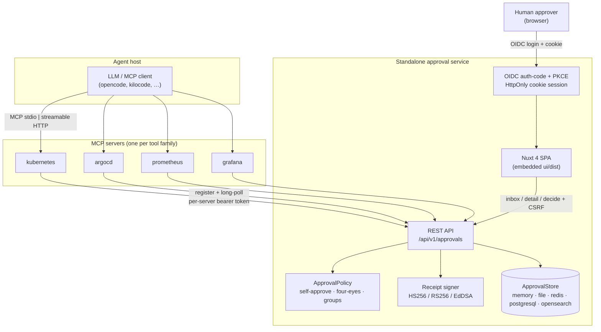
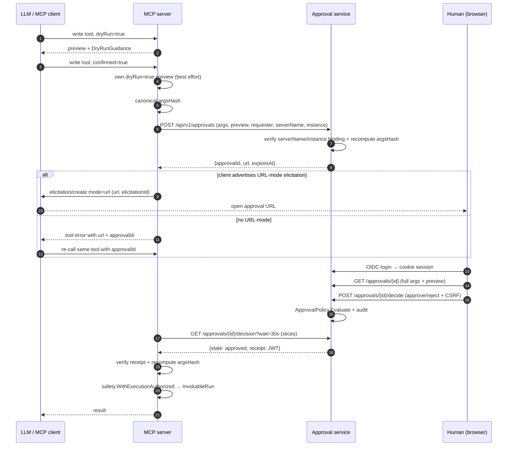
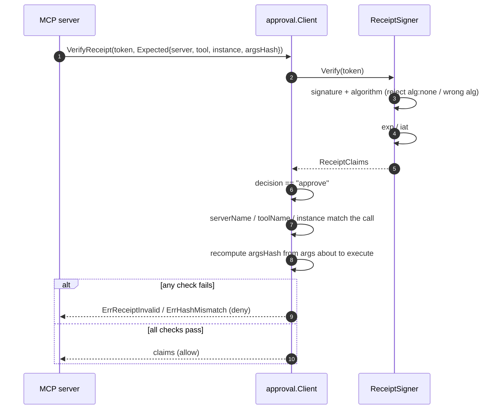
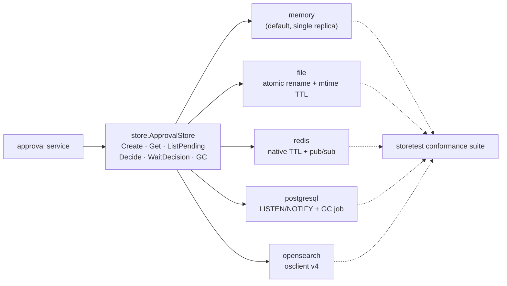

# MCP hard approval — standalone approval service + web UI

> Scope: `libs/mcp/approval`, `libs/mcp` (`ApprovalURLAuthorizer`, adapter
> `approvalId` inject/strip), `server/approval/**`, `libs/toolkit/safety`
> audit metadata. Implementation plan:
> [`.opencode/plans/mcp-hard-approval-service.md`](../../.opencode/plans/mcp-hard-approval-service.md).

## 1. Why

`libs/mcp` already gates write tools with `ElicitationAuthorizer` (MCP
`session.Elicit`). That gate is server-side and not LLM-validated, but it is
weak for infrastructure changes:

| Weakness | Impact |
|---|---|
| Elicitation is an optional client capability | Clients without it are dry-run only |
| Prompt rendered by the agent's own client | Same process/user/UI the LLM drives |
| No separation of duties | Requester == approver, always |
| Visual binding only | A byte-size heuristic blocks ordinary payloads while passing the most destructive calls |

The hard-approval service moves the decision **out of band**: an authenticated
human decides in a browser, independent of the agent process, the LLM and the
MCP client UI. The MCP server verifies a signed receipt bound to the exact
arguments before executing.

## 2. Topology

The approval service owns all approval state. MCP servers hold none, so the
in-memory store is valid for a single replica; persistent backends exist for the
approval service's own restart survival / HA, not for cross-server sharing.

## 3. Approval flow

Key properties:

- The MCP server runs its **own** `dryRun=true` preview; the approval service
  has no tools. A preview failure is a warning shown in the UI, never an
  approval.
- The server TTL (15m) is longer than the MCP timeout (5m), so a decision
  survives a client that gave up polling. A later `approvalId` re-call can still
  succeed.
- Long-poll holds at most 30s per slice; clients re-issue until their timeout.

## 4. Receipt verification

Claims: `approvalId`, `serverName`, `toolName`, `instance`, `requesterSub`,
`approverSub`, `argsHash`, `decision`, `policy`, `iat`, `exp` (2m), `jti`.
Receipts are **reusable within `exp`**; every use is audited with the `jti`.
`argsHash` still prevents approving X and running Y.

### `argsHash` canonicalization

SHA-256 over JCS-style canonical JSON (RFC 8785 semantics: sorted keys, no
insignificant whitespace, stable number formatting) of the tool arguments,
**excluding** `dryRun`, `confirmed` and `approvalId`. Both services must agree
byte-for-byte; the vectors are unit-tested in
`libs/mcp/approval/canonical_test.go`.

## 5. Store backends

| Backend | Wake-up | Expiry | Notes |
|---|---|---|---|
| `memory` | in-process channel | clock check + GC | default; single replica |
| `file` | polling (250ms) | mtime + GC | atomic temp-file rename; path-traversal guard |
| `redis` | pub/sub | native key TTL | atomic `Decide` via Lua |
| `postgresql` | `LISTEN/NOTIFY` | `expires_at` + GC | `SELECT … FOR UPDATE` |
| `opensearch` | polling (250ms) | `expiresAtUnix` + GC | index created on startup |

Every backend runs the same `storetest.Run` conformance suite. External-service
tests are gated on `REDIS_ADDR`, `POSTGRES_DSN` and `OPENSEARCH_URL` and skip
cleanly when unset.

## 6. Security controls

| Control | Implementation |
|---|---|
| Browser session | OIDC auth-code + PKCE; random 256-bit id; server-side record; rotation on login; explicit logout |
| Cookie | `HttpOnly`, `Secure`, `SameSite=Lax`, host-only |
| CSRF | double-submit token on `POST /decide` and logout; mismatch → 403 |
| CSP | `default-src 'self'`, no `unsafe-inline`/`unsafe-eval`, nonce for the SPA bootstrap |
| Headers | `X-Content-Type-Options: nosniff`, `Referrer-Policy: no-referrer`, `X-Frame-Options: DENY` |
| MCP→service auth | per-server bearer token, SHA-256 at rest, constant-time compare, bound to `ServerName` + allowed instances |
| Anti-phishing | default self-approve policy only lets the requester decide; `approvalId` is an opaque lookup key with no authority |
| Decision integrity | signed receipt bound to `argsHash`; `alg:none` and wrong algorithms rejected |
| Fail closed | no session, unreachable service, 5xx, bad signature, hash mismatch, expiry, decline, policy denial → deny + audit |
| No token passthrough | the end user's MCP bearer token is never forwarded |

### Disclosed truncation (elicitation path)

There is no argument-size rejection limit. The elicitation prompt renders up to
`ApprovalDisplayBudget` (4000) bytes and, when the payload is larger, states
`showing N of M bytes — remainder NOT displayed` and shows the full `argsHash`.
The audit event records `argsHash` and `argsTruncated`. The service path adds no
size check of its own: the browser renders the full payload and diff, and the
receipt binds the approved bytes to the executed bytes.

## 7. Implementation deep-dives

### 7.1 Adapter `approvalId` inject/strip

`inputSchemaJSON(info, isWrite)` publishes `approvalId` as an optional string
property for write tools only. `makeHandler` calls `stripApprovalID` before
anything else, so the typed params structs of the nine write tools stay
untouched and `InvokableRun` never sees the field. The stripped id is passed to
`ApprovalURLAuthorizer`; the canonical `argsHash` excludes it.

### 7.2 `ApprovalURLAuthorizer`

1. `approvalId` present → `WaitDecision` → `verify`.
2. Otherwise: best-effort preview → `Register` → URL-mode elicitation or
   error+`approvalId` fallback → `WaitDecision` → `verify`.
3. `verify` checks state, then `Client.VerifyReceipt` with the expected
   server/tool/instance/hash. `LastReceipt()` exposes the verified claims so the
   adapter can emit `approval-granted` / `approval-denied` audit events with
   `approvalId`, `approverSub`, `jti`, `decision` and `policy`.

### 7.3 Service request path

`handleRegister` validates the credential binding, recomputes `argsHash`,
applies the TTL, stores the record, writes an independent audit event and calls
the `Notifier`. `handleDecision` long-polls the store, checks the record belongs
to the credential's server, and issues a receipt only for `approved` records.
`handleDecide` evaluates `ApprovalPolicy` before recording the decision, so a
denied approver never mutates the record.

### 7.4 Policy evaluation

`ApprovalPolicy.Evaluate` matches rules by tool/instance/operation. A matching
rule enforces four-eyes, approver users and approver groups. With no matching
rule the default is self-approve: only the requester may decide, which also
blocks a different user from opening another user's approval URL. The comparison
is `session.Sub` (the browser's OIDC `sub`) against the record's `requesterSub`;
the MCP server sends its OIDC `sub` as `requester.sub` (its `Identity.Sub`,
default `SubClaim: "sub"`), so both sides must map the same claim or self-approve
fails closed.

### 7.5 UI build and embedding

The Nuxt 4 SPA (`ssr:false`) builds to `server/approval/ui/dist`, which is
committed and embedded with `//go:embed all:ui/dist`. `make ui` rebuilds it; CI
rebuilds and fails if the committed dist is stale (`git diff --exit-code --
server/approval/ui/dist`). The SPA handler serves `index.html` with a per-request
CSP nonce and falls back to it for client-side routes.
