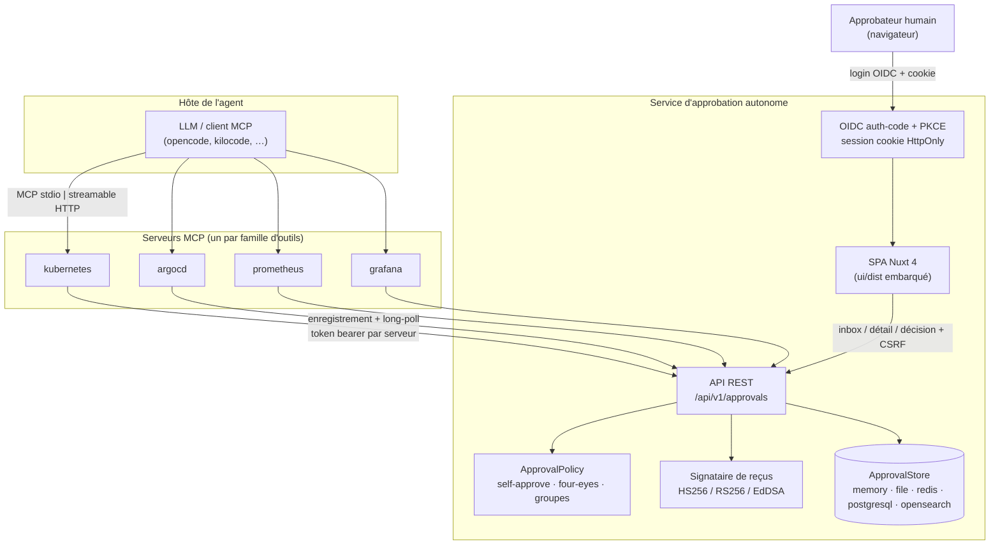
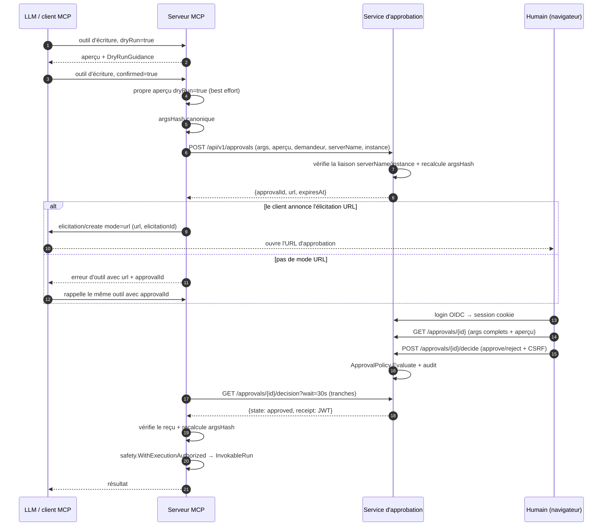
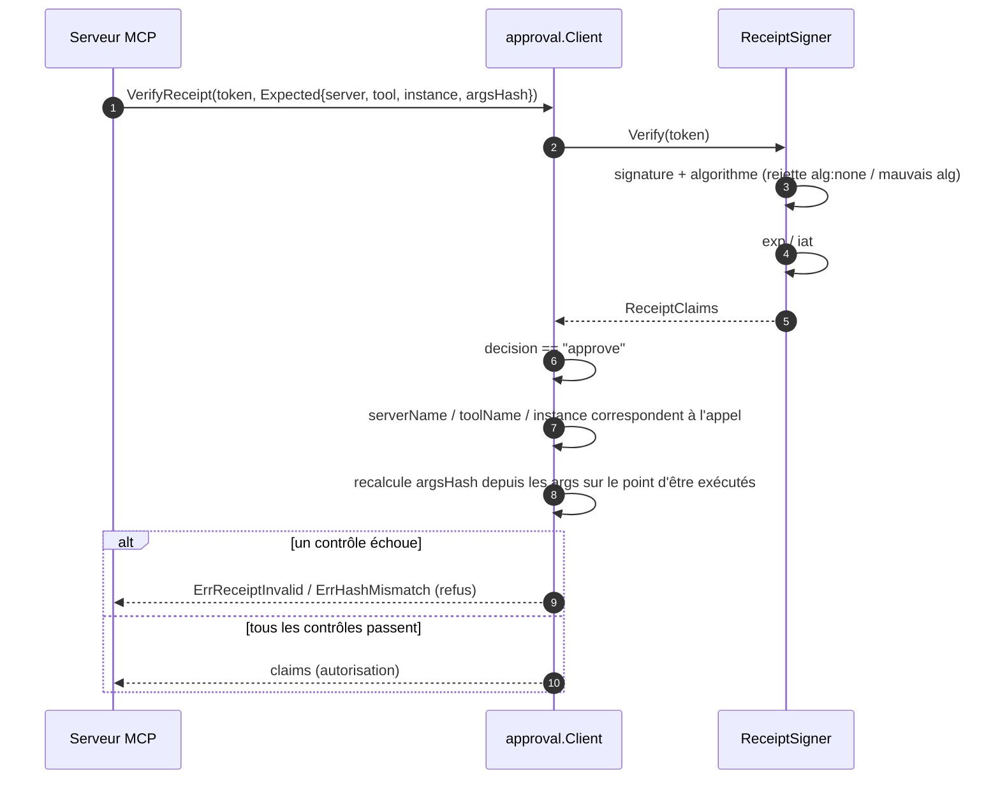
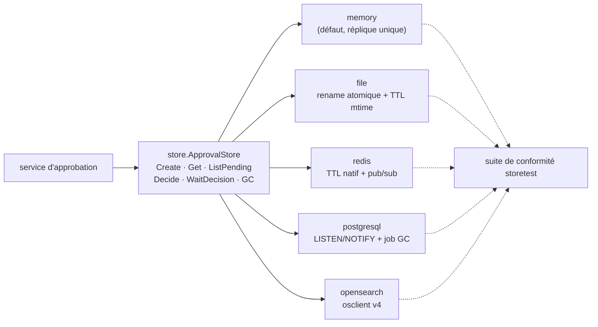

# Approbation forte MCP — service d'approbation autonome + UI web

> Périmètre : `libs/mcp/approval`, `libs/mcp` (`ApprovalURLAuthorizer`,
> injection/suppression de `approvalId` dans l'adaptateur), `server/approval/**`,
> métadonnées d'audit de `libs/toolkit/safety`. Plan d'implémentation :
> [`.opencode/plans/mcp-hard-approval-service.md`](../../.opencode/plans/mcp-hard-approval-service.md).

## 1. Pourquoi

`libs/mcp` protège déjà les outils d'écriture avec `ElicitationAuthorizer`
(`session.Elicit` MCP). Cette porte est côté serveur et non validée par le LLM,
mais elle est faible pour des changements d'infrastructure :

| Faiblesse | Impact |
|---|---|
| L'élicitation est une capacité client optionnelle | Les clients sans elle sont limités au dry-run |
| L'invite est rendue par le client de l'agent | Même processus/utilisateur/UI que le LLM pilote |
| Aucune séparation des devoirs | Demandeur == approbateur, toujours |
| Liaison visuelle seulement | Une heuristique de taille bloque les charges ordinaires tout en laissant passer les appels les plus destructeurs |

Le service d'approbation forte déplace la décision **hors bande** : un humain
authentifié décide dans un navigateur, indépendamment du processus de l'agent, du
LLM et de l'UI du client MCP. Le serveur MCP vérifie un reçu signé lié aux
arguments exacts avant d'exécuter.

## 2. Topologie

Le service d'approbation possède tout l'état d'approbation. Les serveurs MCP n'en
possèdent aucun, donc le store en mémoire est valide pour une réplique unique ;
les backends persistants servent à la survie au redémarrage / HA du service
d'approbation, pas au partage entre serveurs.

## 3. Flux d'approbation

Propriétés clés :

- Le serveur MCP exécute son **propre** aperçu `dryRun=true` ; le service
  d'approbation n'a pas d'outils. Un échec d'aperçu est un avertissement affiché
  dans l'UI, jamais une approbation.
- Le TTL serveur (15m) est plus long que le timeout MCP (5m), donc une décision
  survit à un client qui a abandonné le polling. Un rappel ultérieur avec
  `approvalId` peut encore réussir.
- Le long-poll tient au plus 30s par tranche ; les clients réémettent jusqu'à
  leur timeout.

## 4. Vérification du reçu

Claims : `approvalId`, `serverName`, `toolName`, `instance`, `requesterSub`,
`approverSub`, `argsHash`, `decision`, `policy`, `iat`, `exp` (2m), `jti`.
Les reçus sont **réutilisables dans `exp`** ; chaque usage est audité avec le
`jti`. `argsHash` empêche toujours d'approuver X et d'exécuter Y.

### Canonicalisation de `argsHash`

SHA-256 sur du JSON canonique de style JCS (sémantique RFC 8785 : clés triées,
aucun espace insignifiant, formatage stable des nombres) des arguments de
l'outil, **en excluant** `dryRun`, `confirmed` et `approvalId`. Les deux services
doivent produire des octets identiques ; les vecteurs sont testés dans
`libs/mcp/approval/canonical_test.go`.

## 5. Backends de stockage

| Backend | Réveil | Expiration | Notes |
|---|---|---|---|
| `memory` | canal en processus | contrôle d'horloge + GC | défaut ; réplique unique |
| `file` | polling (250ms) | mtime + GC | rename atomique ; garde anti-traversée |
| `redis` | pub/sub | TTL natif de clé | `Decide` atomique via Lua |
| `postgresql` | `LISTEN/NOTIFY` | `expires_at` + GC | `SELECT … FOR UPDATE` |
| `opensearch` | polling (250ms) | `expiresAtUnix` + GC | index créé au démarrage |

Chaque backend exécute la même suite de conformité `storetest.Run`. Les tests
des services externes sont conditionnés par `REDIS_ADDR`, `POSTGRES_DSN` et
`OPENSEARCH_URL` et s'ignorent proprement quand ils ne sont pas définis.

## 6. Contrôles de sécurité

| Contrôle | Implémentation |
|---|---|
| Session navigateur | OIDC auth-code + PKCE ; id aléatoire 256 bits ; enregistrement côté serveur ; rotation au login ; logout explicite |
| Cookie | `HttpOnly`, `Secure`, `SameSite=Lax`, host-only |
| CSRF | token double-submit sur `POST /decide` et logout ; échec → 403 |
| CSP | `default-src 'self'`, pas de `unsafe-inline`/`unsafe-eval`, nonce pour le bootstrap de la SPA |
| En-têtes | `X-Content-Type-Options: nosniff`, `Referrer-Policy: no-referrer`, `X-Frame-Options: DENY` |
| Auth MCP→service | token bearer par serveur, SHA-256 au repos, comparaison à temps constant, lié à `ServerName` + instances autorisées |
| Anti-hameçonnage | la politique self-approve par défaut ne laisse que le demandeur décider ; `approvalId` est une clé de recherche opaque sans autorité |
| Intégrité de la décision | reçu signé lié à `argsHash` ; `alg:none` et mauvais algorithmes rejetés |
| Fail closed | pas de session, service injoignable, 5xx, mauvaise signature, hash différent, expiration, refus, refus de politique → refus + audit |
| Pas de passthrough de token | le token bearer MCP de l'utilisateur final n'est jamais transmis |

### Troncature divulguée (chemin élicitation)

Il n'y a aucune limite de rejet sur la taille des arguments. L'invite
d'élicitation affiche jusqu'à `ApprovalDisplayBudget` (4000) octets et, au-delà,
indique `showing N of M bytes — remainder NOT displayed` ainsi que l'`argsHash`
complet. L'événement d'audit enregistre `argsHash` et `argsTruncated`. Le chemin
service n'ajoute aucun contrôle de taille : le navigateur affiche la charge
complète et le diff, et le reçu lie les octets approuvés aux octets exécutés.

## 7. Plongées dans l'implémentation

### 7.1 Injection/suppression de `approvalId` dans l'adaptateur

`inputSchemaJSON(info, isWrite)` publie `approvalId` comme propriété chaîne
optionnelle pour les outils d'écriture uniquement. `makeHandler` appelle
`stripApprovalID` avant tout le reste, donc les structs de paramètres typés des
neuf outils d'écriture restent intacts et `InvokableRun` ne voit jamais le champ.
L'id extrait est passé à `ApprovalURLAuthorizer` ; l'`argsHash` canonique
l'exclut.

### 7.2 `ApprovalURLAuthorizer`

1. `approvalId` présent → `WaitDecision` → `verify`.
2. Sinon : aperçu best-effort → `Register` → élicitation URL ou repli
   erreur+`approvalId` → `WaitDecision` → `verify`.
3. `verify` contrôle l'état, puis `Client.VerifyReceipt` avec le
   serveur/outil/instance/hash attendus. `LastReceipt()` expose les claims
   vérifiés pour que l'adaptateur émette les événements d'audit
   `approval-granted` / `approval-denied` avec `approvalId`, `approverSub`,
   `jti`, `decision` et `policy`.

### 7.3 Chemin de requête du service

`handleRegister` valide la liaison du credential, recalcule `argsHash`, applique
le TTL, stocke l'enregistrement, écrit un événement d'audit indépendant et
appelle le `Notifier`. `handleDecision` interroge le store en long-poll, vérifie
que l'enregistrement appartient au serveur du credential, et n'émet un reçu que
pour les enregistrements `approved`. `handleDecide` évalue `ApprovalPolicy` avant
d'enregistrer la décision, donc un approbateur refusé ne mute jamais
l'enregistrement.

### 7.4 Évaluation de la politique

`ApprovalPolicy.Evaluate` fait correspondre les règles par
outil/instance/opération. Une règle correspondante impose four-eyes, les
utilisateurs approbateurs et les groupes approbateurs. Sans règle correspondante,
le défaut est self-approve : seul le demandeur peut décider, ce qui bloque aussi
un autre utilisateur ouvrant l'URL d'approbation de quelqu'un d'autre. La
comparaison est `session.Sub` (le `sub` OIDC du navigateur) contre le
`requesterSub` de l'enregistrement ; le serveur MCP envoie son `sub` OIDC comme
`requester.sub` (son `Identity.Sub`, `SubClaim: "sub"` par défaut), donc les deux
côtés doivent mapper la même claim, sinon self-approve échoue fermé.

### 7.5 Build et embarquement de l'UI

La SPA Nuxt 4 (`ssr:false`) build vers `server/approval/ui/dist`, qui est
committé et embarqué avec `//go:embed all:ui/dist`. `make ui` le reconstruit ; la
CI reconstruit et échoue si le dist committé est périmé (`git diff --exit-code --
server/approval/ui/dist`). Le handler SPA sert `index.html` avec un nonce CSP par
requête et y retombe pour les routes côté client.
