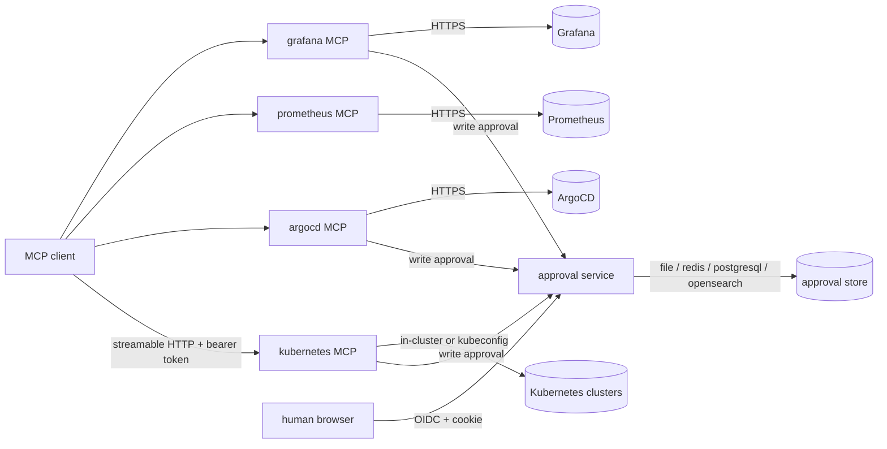
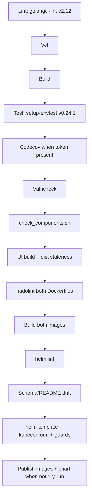
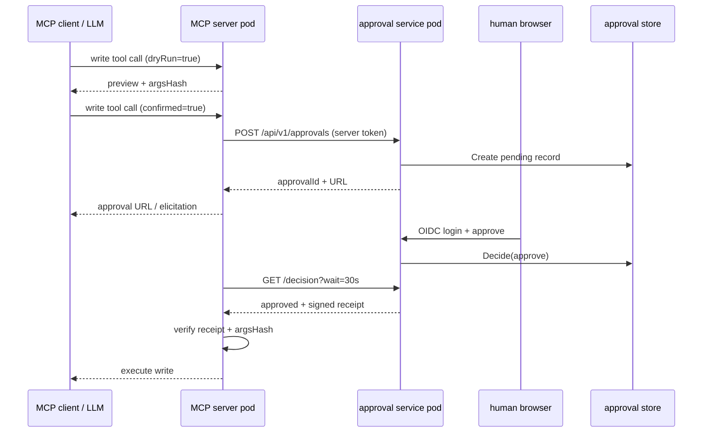

# Deployment and CI

This document describes how the eino-ext MCP servers and the standalone
approval service are packaged, configured, deployed and validated.

## Overview

Two container images are produced from one Go module:

| Image | Entrypoint | Purpose |
|---|---|---|
| `eino-ext/mcp` | `cmd/mcp-server` | One MCP server per tool family (`kubernetes`, `argocd`, `prometheus`, `grafana`) |
| `eino-ext/approval` | `server/approval/cmd` | Out-of-band human approval service with the embedded Nuxt UI |

Both images are built from `distroless/static-debian12:nonroot`, run as UID
65532, and expose no shell. Probes are therefore HTTP `httpGet` probes.

## Deployment topology

MCP Services are `ClusterIP` only. The unauthenticated operations port `9090`
(`/healthz`, `/readyz`, `/metrics`) is never part of a Service or Ingress. The
approval service is exposed through an optional Ingress.

## Configuration and secrets

`cmd/mcp-server` loads a YAML file through `libs/mcp/serverconfig`. The approval
binary loads its own YAML file through `server/approval/cmd`. Both reject
unknown keys and validate URLs, durations and required fields.

Precedence is **flags > environment > file > defaults**. Secrets are references
only:

- `*File` reads a file, trims trailing `\n`/`\r\n`, rejects empty values and
  rejects files larger than 64 KiB.
- `*Env` reads an environment variable and rejects unset or empty values.
- When both are set, `*File` wins.
- Secrets are resolved **after** viper unmarshalling, so they never enter
  viper's key space or `AllSettings()`.

The Helm chart mounts every secret as a read-only file. No secret is passed as
an argument or an environment variable in the Kubernetes path.

## Helm chart

`helm/eino-ext` deploys the approval service and one Deployment, Service,
ConfigMap, Secret and ServiceAccount per enabled MCP family.

Security defaults:

- Kubernetes RBAC is read-only (`get`, `list`, `watch`). `allowWrite` and
  `allowExec` are explicit, dangerous opt-ins.
- MCP authentication is enabled. A random admin token is generated when no
  tokens are configured.
- Approval is enabled for write-capable families.
- Pods run as non-root, with a read-only root filesystem, dropped capabilities
  and `seccompProfile: RuntimeDefault`. An `emptyDir` is mounted at `/tmp`.
- The file store uses a PVC with `fsGroup: 65532` and `strategy: Recreate`.

The chart fails at render time when:

- `approval.replicaCount > 1` or HPA is enabled with a `memory`/`file` store.
- A family is enabled with zero clusters/instances.
- `mcp.auth.enabled` is false while `allowWrite` or `allowExec` is true.
- OIDC is enabled without an issuer or client ID.
- OIDC is enabled without a client secret (a generated secret cannot
  authenticate to the IdP).
- The `file` store is selected with `persistence.enabled: false` (the root
  filesystem is read-only and no volume is mounted at the store path).
- A required `existingSecret` key is missing (checked with `lookup` when a
  cluster is available).

## CI pipeline

`.github/workflows/ci.yml` calls a Dagger module (`.dagger/`) pinned to Dagger
`v0.21.10`. The module never calls the upstream `Golang.Ci`, because it runs
`gofumpt -w` over the whole repository.

`Test` installs `setup-envtest@v0.24.1` (matching controller-runtime in
`go.mod`), downloads Kubernetes `1.34.0` assets into a cache volume, exports
`KUBEBUILDER_ASSETS`, and writes `coverage.out`. `Lint` installs
`golangci-lint@v2.12.0` into `/usr/local/bin`, outside the cache-mounted
`$GOPATH/bin`.

## Approval sequence across pods

The MCP server fails closed: an unreachable approval service, a bad receipt, a
hash mismatch, a decline or an expiry denies execution.

## Implementation deep-dives

### `libs/mcp/serverconfig`

`Load` builds a viper instance with `EINO_MCP_*` environment support, applies
defaults, reads the YAML file, applies CLI overrides, unmarshals with
`ErrorUnused: true`, resolves secret references, validates the selected family
and calls `validate.Struct`. `Build` translates the family entries into the
existing `components/tool/*` configs and calls the matching
`components/mcp/*.NewServer`. Client construction stays lazy.

### Operations port

`cmd/mcp-server` owns both HTTP servers. The MCP listener uses
`srv.HTTPHandler()`; the ops listener uses `serverconfig.OpsHandler`. On
`SIGINT`/`SIGTERM` the MCP listener drains first, then the ops listener, with a
10s budget. With `--transport stdio` no listener is started at all.

### Dagger module

`.dagger/` is a nested Go module, invisible to the repository's `go build`,
`go vet` and `golangci-lint`. It depends on
`disaster37/dagger-library-go@2.0.20` pinned to commit
`e205189be6eba617e7bcc870db2e73a04171f38e`. The module exposes granular
functions (`lint`, `vet`, `build`, `test`, `vulncheck`, `check-components`,
`ui`, `lint-images`, `image-mcp`, `image-approval`, `helm-lint`,
`helm-template`, `helm-schema`, `helm-docs`, `helm-publish`, `ci`,
`integration-test`).

### Image build

`Dockerfile.mcp` and `Dockerfile.approval` pin every base image by tag and
digest. The approval image builds the Nuxt UI in a Node stage and copies the
result over the committed `ui/dist` before `go build`, so the embedded UI is
always built from source. The Dagger `ui` function separately asserts the
committed `dist` is not stale.

### Chart secret wiring

The chart generates one shared receipt secret and one approval token per
write-capable family. The plaintext token is written to the family Secret; its
SHA-256 hash is written to the approval credential file as
`<family>=sha256:<hash>@<instances>`. `lookup` preserves generated values across
upgrades. `existingSecret` is supported for every secret-bearing component and
is the recommended production path (ExternalSecrets/SealedSecrets).
