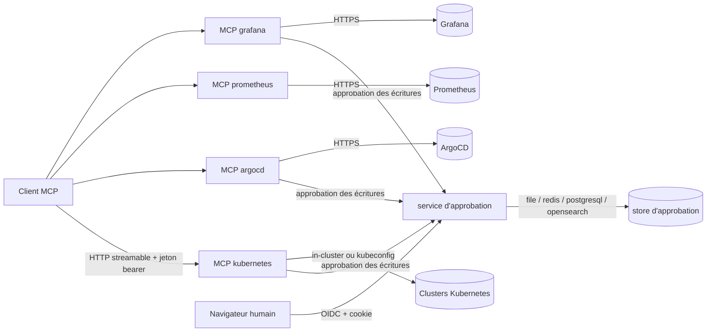
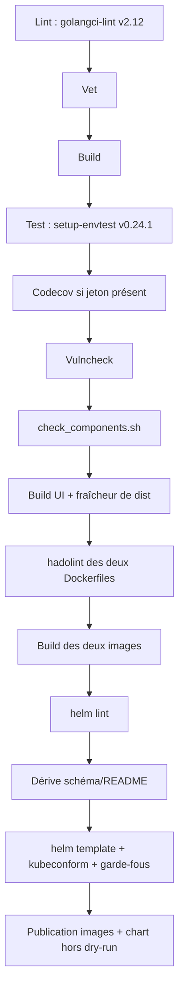
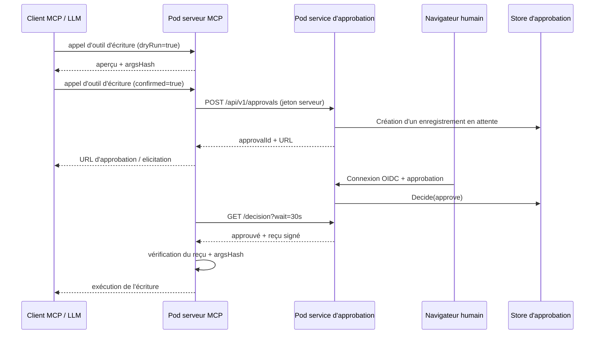

# Déploiement et CI

Ce document décrit comment les serveurs MCP d'eino-ext et le service
d'approbation autonome sont empaquetés, configurés, déployés et validés.

## Vue d'ensemble

Deux images de conteneur sont produites à partir d'un seul module Go :

| Image | Point d'entrée | Rôle |
|---|---|---|
| `eino-ext/mcp` | `cmd/mcp-server` | Un serveur MCP par famille d'outils (`kubernetes`, `argocd`, `prometheus`, `grafana`) |
| `eino-ext/approval` | `server/approval/cmd` | Service d'approbation humaine hors bande avec l'UI Nuxt embarquée |

Les deux images sont basées sur `distroless/static-debian12:nonroot`,
s'exécutent avec l'UID 65532 et n'exposent aucun shell. Les sondes sont donc des
sondes HTTP `httpGet`.

## Topologie de déploiement

Les Services MCP sont uniquement de type `ClusterIP`. Le port d'opérations
`9090` (`/healthz`, `/readyz`, `/metrics`), non authentifié, ne fait partie
d'aucun Service ni Ingress. Le service d'approbation est exposé via un Ingress
optionnel.

## Configuration et secrets

`cmd/mcp-server` charge un fichier YAML via `libs/mcp/serverconfig`. Le binaire
d'approbation charge son propre fichier YAML via `server/approval/cmd`. Les deux
rejettent les clés inconnues et valident les URL, les durées et les champs
obligatoires.

La priorité est **flags > environnement > fichier > valeurs par défaut**. Les
secrets ne sont que des références :

- `*File` lit un fichier, supprime les `\n`/`\r\n` finaux, rejette une valeur
  vide et rejette les fichiers de plus de 64 Kio.
- `*Env` lit une variable d'environnement et rejette une valeur absente ou vide.
- Si les deux sont définis, `*File` gagne.
- Les secrets sont résolus **après** le démarshalling viper : ils n'entrent
  jamais dans l'espace de clés de viper ni dans `AllSettings()`.

Le chart Helm monte chaque secret en fichier en lecture seule. Aucun secret
n'est passé en argument ni en variable d'environnement dans le chemin
Kubernetes.

## Chart Helm

`helm/eino-ext` déploie le service d'approbation et, pour chaque famille MCP
activée, un Deployment, un Service, une ConfigMap, un Secret et un
ServiceAccount.

Valeurs par défaut de sécurité :

- Le RBAC Kubernetes est en lecture seule (`get`, `list`, `watch`).
  `allowWrite` et `allowExec` sont des opt-ins explicites et dangereux.
- L'authentification MCP est activée. Un jeton admin aléatoire est généré quand
  aucun jeton n'est configuré.
- L'approbation est activée pour les familles capables d'écriture.
- Les pods s'exécutent en non-root, avec un système de fichiers racine en
  lecture seule, les capabilities supprimées et
  `seccompProfile: RuntimeDefault`. Un `emptyDir` est monté sur `/tmp`.
- Le store `file` utilise un PVC avec `fsGroup: 65532` et
  `strategy: Recreate`.

Le chart échoue au rendu lorsque :

- `approval.replicaCount > 1` ou l'HPA est activé avec un store
  `memory`/`file`.
- Une famille est activée sans cluster/instance.
- `mcp.auth.enabled` est faux alors que `allowWrite` ou `allowExec` est vrai.
- OIDC est activé sans issuer ni client ID.
- Une clé obligatoire manque dans un `existingSecret` (vérifié via `lookup`
  quand un cluster est disponible).

## Pipeline CI

`.github/workflows/ci.yml` appelle un module Dagger (`.dagger/`) épinglé à
Dagger `v0.21.10`. Le module n'appelle jamais `Golang.Ci` en amont, car il
exécute `gofumpt -w` sur tout le dépôt.

`Test` installe `setup-envtest@v0.24.1` (aligné sur controller-runtime dans
`go.mod`), télécharge les assets Kubernetes `1.34.0` dans un volume de cache,
exporte `KUBEBUILDER_ASSETS` et écrit `coverage.out`. `Lint` installe
`golangci-lint@v2.12.0` dans `/usr/local/bin`, hors du `$GOPATH/bin` monté en
cache.

## Séquence d'approbation entre pods

Le serveur MCP échoue fermé : un service d'approbation injoignable, un mauvais
reçu, un hash différent, un refus ou une expiration empêchent l'exécution.

## Plongées dans l'implémentation

### `libs/mcp/serverconfig`

`Load` construit une instance viper avec le support d'environnement
`EINO_MCP_*`, applique les valeurs par défaut, lit le fichier YAML, applique les
surcharges CLI, démarshalle avec `ErrorUnused: true`, résout les références de
secrets, valide la famille sélectionnée puis appelle `validate.Struct`. `Build`
traduit les entrées de famille en configurations `components/tool/*` existantes
et appelle le `components/mcp/*.NewServer` correspondant. La construction des
clients reste paresseuse.

### Port d'opérations

`cmd/mcp-server` possède les deux serveurs HTTP. L'écouteur MCP utilise
`srv.HTTPHandler()` ; l'écouteur d'opérations utilise
`serverconfig.OpsHandler`. Sur `SIGINT`/`SIGTERM`, l'écouteur MCP draine en
premier, puis l'écouteur d'opérations, avec un budget de 10 s. Avec
`--transport stdio`, aucun écouteur n'est démarré.

### Module Dagger

`.dagger/` est un module Go imbriqué, invisible pour `go build`, `go vet` et
`golangci-lint` du dépôt. Il dépend de
`disaster37/dagger-library-go@2.0.20` épinglé au commit
`e205189be6eba617e7bcc870db2e73a04171f38e`. Le module expose des fonctions
granulaires (`lint`, `vet`, `build`, `test`, `vulncheck`, `check-components`,
`ui`, `lint-images`, `image-mcp`, `image-approval`, `helm-lint`,
`helm-template`, `helm-schema`, `helm-docs`, `helm-publish`, `ci`,
`integration-test`).

### Build des images

`Dockerfile.mcp` et `Dockerfile.approval` épinglent chaque image de base par tag
et digest. L'image d'approbation construit l'UI Nuxt dans une étape Node et
copie le résultat par-dessus le `ui/dist` versionné avant `go build`, afin que
l'UI embarquée soit toujours construite depuis les sources. La fonction Dagger
`ui` vérifie séparément que le `dist` versionné n'est pas obsolète.

### Câblage des secrets du chart

Le chart génère un secret de reçu partagé et un jeton d'approbation par famille
capable d'écriture. Le jeton en clair est écrit dans le Secret de la famille ;
son hash SHA-256 est écrit dans le fichier de credentials d'approbation sous la
forme `<famille>=sha256:<hash>@<instances>`. `lookup` préserve les valeurs
générées lors des upgrades. `existingSecret` est pris en charge pour chaque
composant porteur de secret et constitue le chemin de production recommandé
(ExternalSecrets/SealedSecrets).
